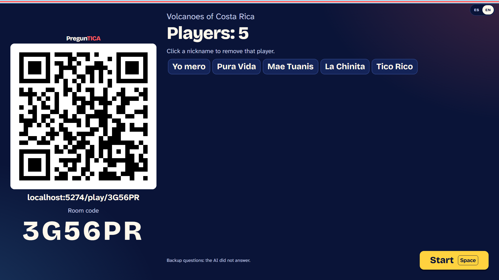
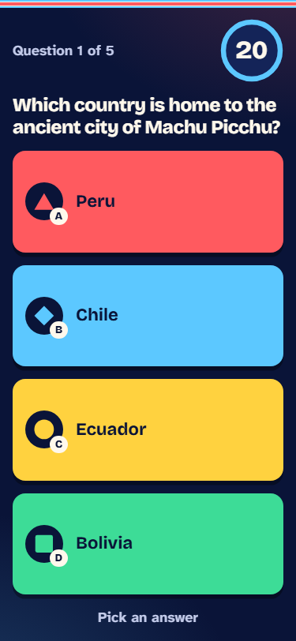
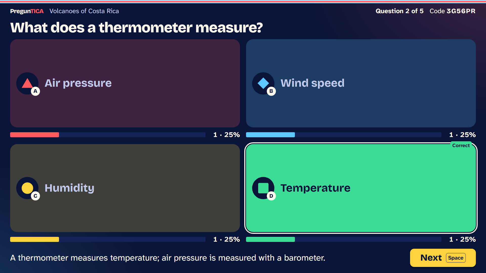
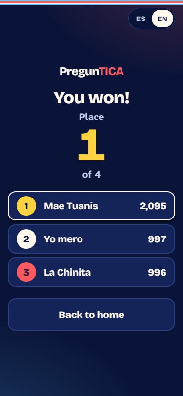
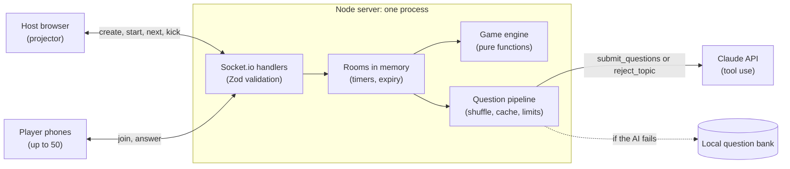

# PregunTICA

Live trivia on any topic, written by AI in seconds.

[](https://github.com/GabeMByte/pregunTICA/actions/workflows/ci.yml)

**Live app:** https://preguntica.onrender.com (Render free plan: the first visit after 15 idle minutes takes a moment to wake up)

<table>
  <tr>
    <td align="center"><br>Lobby on the projector: scan the QR to join</td>
    <td align="center"><br>Question on a phone</td>
  </tr>
  <tr>
    <td align="center"><br>Reveal: correct answer, votes and explanation</td>
    <td align="center"><br>Final podium</td>
  </tr>
</table>

## What it is

PregunTICA is a real-time multiplayer quiz for classrooms and events. The host types any topic, Claude writes the questions, and everyone plays from their phone. A game goes like this:

1. The host opens the app on a projector, types a topic and picks 5 to 15 questions, a difficulty and the question language.
2. Claude writes the questions in a few seconds (instantly if the topic is cached). Meanwhile the lobby shows a QR code and a 6-character room code.
3. Players scan the QR, type a nickname and are in. No accounts, no app to install.
4. Each question has four options and a 20-second timer. Correct answers score 500 to 1000 points depending on speed, plus a streak bonus.
5. After each question the projector reveals the correct answer, how the room voted and a short explanation, followed by the top 5.
6. After the last question, a podium shows the top 3.

## Features

- **Any topic**: questions generated by Claude, with a local backup bank if the AI does not answer.
- **Spanish and English**: the interface follows each device's language, and the question language is chosen separately by the host.
- **Up to 50 players** per room.
- **Join by QR, no sign-up**: the QR opens the join screen with the room code already filled in.
- **Reconnection**: a player who reloads or locks their phone comes back with their score; the host regains control of the room with a secret token.
- **Late joiners**: players can join a game in progress and play from the next question.
- **Kick**: the host can remove a player from the room.
- **Accessible options**: each answer is marked by shape, letter and color (red triangle A, blue diamond B, yellow circle C, green square D), never by color alone. Animations respect reduced motion.

## How it works



The server is authoritative: the game engine is a set of pure functions with time and randomness injected, and no client receives the correct answer before the reveal. Every incoming event is validated with the [Zod](https://zod.dev) schemas in `packages/shared`, the single source of truth for the client-server contract.

**Question generation.** The server calls Claude with two strict tools: `submit_questions` delivers the questions and `reject_topic` declines inappropriate topics or prompt-injection attempts (sensitive but legitimate topics, such as wars or drugs in medicine, are allowed). The topic is passed as delimited data, never as instructions. The answer is validated with Zod plus extra checks (exact count, length limits, unique options, no duplicate questions); if it fails, Claude gets **one retry** with the concrete validation errors. If the API fails, takes longer than 15 seconds or no key is set, the room uses a **local backup bank** and the host is told. A rejected topic closes the room and never falls back to the bank. Generated questions are **cached** in memory by topic, count, difficulty and language, and `WARM_TOPICS` pre-fills the cache at startup. Questions and options are reshuffled on the server for every room, even from the cache, and a global cap (3 generations at once, 60 per hour) limits API spend. Details in [SPEC.md §6](SPEC.md#6-generación-de-preguntas-con-ia) (Spanish).

**Model evaluation.** `pnpm eval:questions` compared two models on 12 topics in 2 languages, including sensitive and adversarial topics ([docs/EVAL.md](docs/EVAL.md), Spanish):

| Model | Valid on first try | Average time | p95 | False rejections | Adversarial topics rejected |
|---|---|---|---|---|---|
| **claude-sonnet-5-5** (default) | **100 %** | **4.3 s** | **5.8 s** | 0/20 | 4/4 |
| claude-haiku-5-5 | 55 % | 5.6 s | 10.0 s | 0/20 | 4/4 |

Haiku's first answers failed only on length limits, which strict tool use cannot enforce, and the retry pushed most of them past the 8-second demo target. End to end in the real app, a new topic was ready in 4 to 6 seconds, a cached one in 5 ms, and a prompt-injection topic was rejected in 1.2 s.

## Built with Claude Code

PregunTICA was built in seven days with [Claude Code](https://claude.com/claude-code). The practices, and where to find them:

- **Spec first**: [SPEC.md](SPEC.md) (rules, events, AI pipeline, accepted risks) was written before any code, in plan mode.
- **Project memory**: [CLAUDE.md](CLAUDE.md) holds the commands, architecture and non-negotiable rules (pure engine, no `correctIndex` before the reveal, Zod at every boundary, never call the real API).
- **TDD with a `test-writer` subagent**: [.claude/agents/test-writer.md](.claude/agents/test-writer.md) writes the failing tests from the spec before the implementation, inside the red-green-refactor loop of the [`/tdd`](.claude/commands/tdd.md) command. Engine coverage is enforced at 90 % or more.
- **`security-reviewer` subagent**: [.claude/agents/security-reviewer.md](.claude/agents/security-reviewer.md) audits the server for cheating and leaks after every change to sockets, rooms or events.
- **Lint hook**: [.claude/hooks/lint-changed.sh](.claude/hooks/lint-changed.sh) runs ESLint on every file Claude edits and sends the errors back so it fixes them on its own ([.claude/settings.json](.claude/settings.json)).
- **Two agents in parallel**: the host and player views were built at the same time by two sessions in separate git worktrees, and merged without conflicts.
- **Visual review with Playwright**: Claude took its own screenshots at 375×812 (phone) and 1920×1080 (projector) in both languages and fixed what it saw before each commit ([docs/screenshots](docs/screenshots)).
- **Guardrails**: `.claude/settings.json` denies the scripts that call the real API, so only a human can spend money.

Every feature is logged in [docs/BITACORA.md](docs/BITACORA.md) (Spanish) with its tests, files and the AI practice used. The main lessons:

- The security subagent found, with a proof of concept, what the tests missed: one socket could fill a room with 50 ghost players.
- Reading the current SDK docs before coding changed the design: forced `tool_choice` and `maxLength` are rejected in strict mode, so limits moved to Zod plus a retry.
- Screenshots and a real phone caught what unit tests could not: an invisible logo, `crypto.randomUUID` missing over plain HTTP on the Wi-Fi, and a reload that closed the question for everyone.
- Rules in a prompt are not enough: after Claude accidentally reached the real API through a `.env` it could not see, the scripts were blocked in the settings.

## Results

Measured on 2026-11-04 on the `master` branch:

| Check | Result |
|---|---|
| Unit tests (Vitest, `pnpm test`) | **1103 passing**: 695 server, 334 web, 74 shared |
| Game engine coverage | 99.38 % statements, 97.67 % branches, 100 % functions, 100 % lines (minimum 90 %) |
| E2E (Playwright, `pnpm test:e2e`) | 7 passing, plus screenshot suites that play full games with several phones, a late joiner and a reconnection |
| Load test on Render free ([docs/LOAD.md](docs/LOAD.md)) | 50/50 players joined (p95 321 ms), questions reached all players with p95 4 ms after the host, 250/250 answers counted, 0 errors |

CI ([.github/workflows/ci.yml](.github/workflows/ci.yml)) runs lint, typecheck and unit tests on every pull request. The load test ran all bots from one machine, so it measures how fast the server fans out events, not phone network latency.

## Tech stack

| Layer | Technology |
|---|---|
| Language and repo | TypeScript 6 (strict), pnpm workspaces, Node.js 24 |
| Frontend | React 19, Vite 8, React Router 8, qrcode.react |
| Real time | Socket.io 4 |
| AI | Claude API through `@anthropic-ai/sdk` (tool use), default model `claude-sonnet-5-5` |
| Validation | Zod 4, shared by client and server |
| Testing | Vitest 5 (with v8 coverage), Testing Library, Playwright |
| Quality and deploy | ESLint 10, GitHub Actions, Docker, Render |

## Project structure

```
pregunTICA/
├── apps/
│   ├── server/
│   │   ├── scripts/          Model evaluation, smoke test and load test (run by a human, real API)
│   │   └── src/
│   │       ├── engine/       Game rules as pure functions: states, scoring, players (TDD)
│   │       ├── ai/           Question generation: Claude, validation, retry, cache, backup banks
│   │       ├── rooms/        In-memory room registry, timers, room codes, rate limits
│   │       ├── socket/       Thin Socket.io handlers: validate with Zod, delegate to the engine
│   │       └── http/         Serves the web build and /health in production
│   └── web/
│       └── src/
│           ├── host/         Projector view (useHostGame)
│           ├── player/       Phone view, mobile first (usePlayerGame)
│           ├── components/   Shared UI: option buttons, timer, ranking cards
│           ├── i18n/         Spanish and English dictionaries
│           ├── net/          Typed socket, local storage, LAN address for the QR
│           ├── game/         Client-side game state helpers
│           ├── routes/       Home page
│           └── styles/       Design tokens and global styles
├── packages/
│   └── shared/               Types, event names and Zod schemas: the client-server contract
├── e2e/                      Playwright multiplayer tests and screenshot suites
├── docs/                     Build log, model evaluation, load test, deployment, screenshots
├── .claude/                  Claude Code subagents, commands, lint hook and permissions
├── .github/workflows/        CI
├── Dockerfile                Single image: server, Socket.io and web build on one port
├── CLAUDE.md                 Instructions for Claude Code
└── SPEC.md                   Product and technical specification (Spanish)
```

## Getting started

### Requirements

- **Node.js 24 or later** (`engines` in `package.json`; `.nvmrc` pins 24).
- **pnpm 12.15.0**, pinned in the `packageManager` field. Run `corepack enable` and Node picks the right version.
- An [Anthropic API key](https://console.anthropic.com/) is optional: without one, every room uses the local question bank.

### Install

```bash
git clone https://github.com/GabeMByte/pregunTICA.git
cd pregunTICA
pnpm install
cp .env.example .env
```

### Environment variables

The server reads the `.env` file at the repository root.

| Variable | Default | What it does |
|---|---|---|
| `ANTHROPIC_API_KEY` | empty | Your Claude API key. Empty means questions come from the local bank. Never commit it. |
| `ANTHROPIC_MODEL` | `claude-sonnet-5-5` | Model that writes the questions ([docs/EVAL.md](docs/EVAL.md) explains the choice). |
| `ANTHROPIC_EFFORT` | `low` | `low`, `medium` or `high`. Lower is faster. |
| `WARM_TOPICS` | `Volcanes de Costa Rica` in `.env.example` | Comma-separated topics generated at startup (Spanish, 5 questions, medium) so they are instant later. **With a key set, this calls the API every time the server starts**; leave it empty to avoid that. |
| `PORT` | `3000` | Server port. The Vite dev server proxies sockets to port 3000, so change it only together with `SERVER_URL` for Vite. |
| `TRUST_PROXY` | `false` | Set to `true` only behind exactly one proxy (Render, Railway): the client IP for the room limit then comes from the last `X-Forwarded-For` value. |

Production also uses `PUBLIC_ORIGIN` (required when `NODE_ENV=production`: the only origin allowed to open a socket), `NODE_ENV` and `STATIC_DIR`, all set by the Docker image or the platform. See [docs/DEPLOY.md](docs/DEPLOY.md).

### Run locally

```bash
pnpm dev
```

This starts the server on http://localhost:3000 and the web app on http://localhost:5173. Open http://localhost:5173, choose **Create a game**, and join from another browser tab with the room code.

### Play with phones on your Wi-Fi

```bash
pnpm dev:lan
```

Same as `pnpm dev`, but the web app listens on your local network and the join QR uses your computer's LAN address. Open the **Network** URL that Vite prints on the projector computer, and players scan the QR from phones on the same Wi-Fi. If no LAN address is found, Vite says so; open the page through your IP so the QR works.

## Scripts

| Script | What it does |
|---|---|
| `pnpm install` | Installs dependencies for every package. |
| `pnpm dev` | Runs the server (3000) and the web app (5173) in parallel, with hot reload. |
| `pnpm dev:lan` | Like `dev`, but reachable from phones on your Wi-Fi. Loads `.env`, so it uses your key if set. |
| `pnpm test` | Unit tests (Vitest) for all packages, with engine coverage. |
| `pnpm test:e2e` | Playwright multiplayer tests. Starts its own servers on other ports with the API key forced empty. |
| `pnpm lint` | ESLint with zero warnings allowed. |
| `pnpm typecheck` | `tsc` type check for every package. |
| `pnpm build` | Production build of the web app and the server. |
| `pnpm eval:questions` | **Warning: calls the real Claude API and costs money.** Compares models on 24 generations each and writes a report. |
| `pnpm smoke --topic "…" [--language en]` | **Warning: calls the real Claude API and costs money.** Creates a real room against a running `pnpm dev` and reports timing. |
| `pnpm load --url <URL> --topic "<topic>"` | **Warning: may call the real Claude API and cost money.** 50 bot players play a full game against a deployed URL. Use a topic from that server's `WARM_TOPICS` so the questions come from the cache. |

## Deployment

The app ships as one Docker image (`Dockerfile`): a single Node process serves `/health`, Socket.io and the web build on the platform's `PORT`. Render is the main target, with steps for Koyeb and Azure App Service too. Set `PUBLIC_ORIGIN`, `TRUST_PROXY=true` and your API key as a secret, and point the health check at `/health`.

> [!WARNING]
> **Always run exactly one instance.** Rooms live in the process memory: with two replicas, a host and their players could land on different processes and never see each other. Do not enable autoscaling, and do not redeploy during a game, since a restart ends every game in progress.

Full instructions, environment table and how to verify the proxy IP: [docs/DEPLOY.md](docs/DEPLOY.md) (Spanish).

## Security and known limitations

What is protected:

- The correct answer never reaches a client before the reveal, and only the first answer per player counts.
- Every socket event and every AI answer is validated with Zod.
- Rate limits: 5 rooms per IP every 10 minutes (IPv6 grouped by /64) and 10 join attempts per socket per minute.
- In production, only `PUBLIC_ORIGIN` can open a socket, checked on the WebSocket handshake as well as CORS.
- The API key never reaches the client or the logs, and AI spend has a global cap.

Known limitations, accepted for this MVP:

- No database: games are lost on a restart or redeploy, and the app must run as a single instance.
- A player's ID works as their reconnection password, and a kicked player can come back with a new one.
- The backup question bank is public in the repository, so a player who knows it could recognize those questions. Players are never told when it is in use.
- Cached questions repeat across rooms with the same topic and settings (in a different order).
- The topic filter does not apply when the backup bank is used.
- The room limit assumes exactly one proxy in front of the server.
- On Render's free plan the service sleeps after 15 idle minutes.

The full list with the reasoning behind each decision is in [SPEC.md §10](SPEC.md#10-riesgos-aceptados) (Spanish).

## License

No license has been granted yet. All rights reserved.
